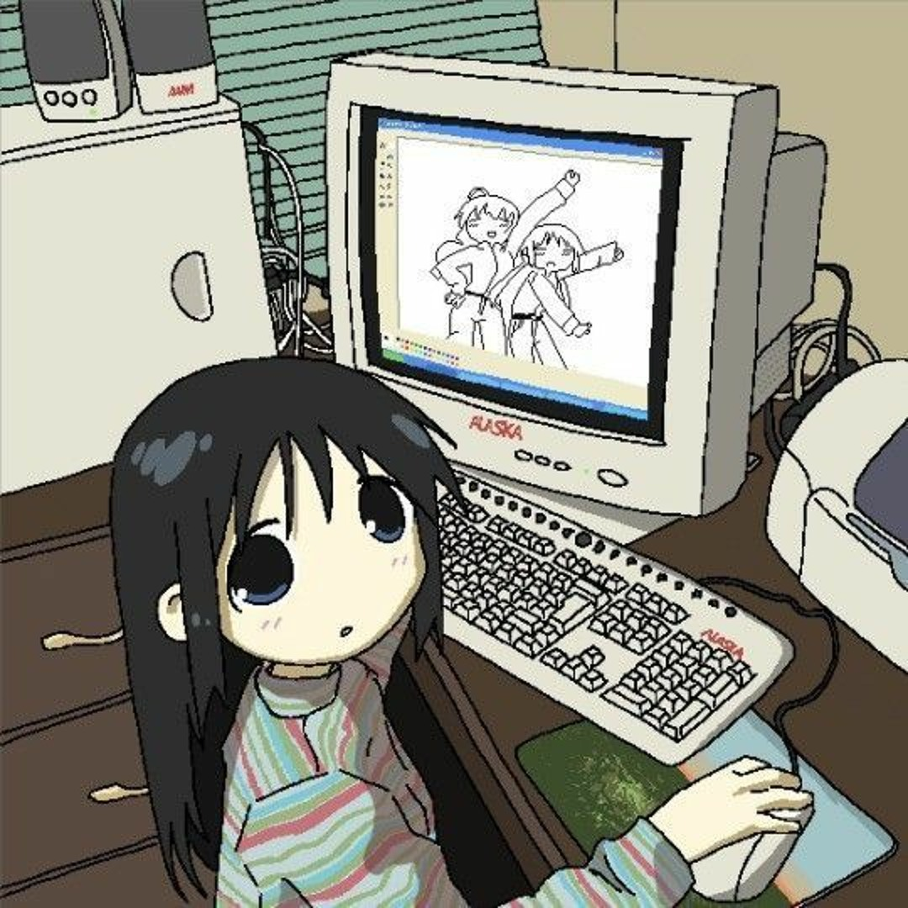

## Hi, I'm CAICAIIs
 
**Undergraduate developer exploring AI infrastructure through open source.**

## 🧭 About Me

- Love coding
- Love watching anime
- Love playing games

  

## 🔭 Currently contributing to

| Project | Area | About |
| --- | --- | --- |
| [Apache Dubbo-Go](https://github.com/apache/dubbo-go) | Go RPC / microservices | Go implementation of Apache Dubbo for building RPC and microservice systems |
| [Apache Seata-Go](https://github.com/apache/incubator-seata-go) | Distributed transactions | Go implementation of Seata for distributed transaction coordination |
| [Fluid](https://github.com/fluid-cloudnative/fluid) | Cloud-native data orchestration | Elastic data abstraction and acceleration for BigData/AI applications in cloud |
| [vLLM Metal](https://github.com/vllm-project/vllm-metal) | LLM runtime on Apple Silicon | Community-maintained vLLM hardware plugin for Apple Silicon |
| [pegainfer](https://github.com/xiaguan/pegainfer) | Rust/CUDA LLM inference | From-scratch LLM inference engine in Rust, CUDA, and Triton without PyTorch runtime |

## 📈 GitHub Activity

  

